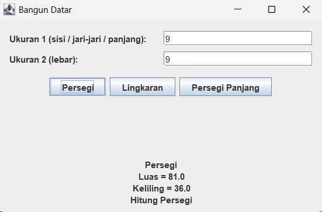
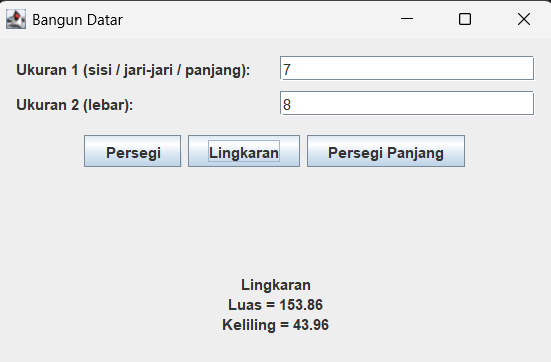

# 🖥️ Latihan GUI Java Swing - Bangun Datar

Latihan/eksplorasi materi **Graphical User Interface (GUI)** pada Java ☕
Program menghitung **luas dan keliling** bangun datar (Persegi, Lingkaran, Persegi Panjang).

## 👤 Identitas

| Data | Keterangan |
|---|---|
| 👤 **Nama** | Zhylalan Wahyu Ramadhani |
| 🆔 **NIM** | F1D02510137 |
| 🏫 **Kelas** | 3B |
| 📘 **Mata Kuliah** | Pemrograman Berorientasi Objek (PBO) |
| 👨‍🏫 **Dosen Pengampu** | Rovana Afwani, S.T., M.T. |

## 📁 Isi Repositori

| Isi | Keterangan |
|-----|------------|
| 💻 **Kode** | `GuiBangun.java`, berisi tiga bagian berurutan: 1. Abstract Class, 2. Interface, 3. GUI |
| 📝 **README** | `README.md`, informasi 5 komponen utama GUI (class/interface) dan penerapan OOP |
| 📸 **Screenshot** | Folder `screenshot/` berisi tampilan awal dan contoh hasil |

GuiBangun.java
README.md
Screenshoot/
 ├─ Tampilan Awal.png
 ├─ Persegi Panjang.png
 ├─ Persegi.png
 └─ Lingkaran.png

> 📝 Semua class berada dalam satu file `GuiBangun.java`. Class `GuiBangun` bersifat `public` dan berisi `main`.

## 🧩 5 Komponen Utama GUI

| No | Komponen | Class / Interface | Fungsi di program |
|:--:|----------|-------------------|-------------------|
| 1️⃣ | 🪟 **Top-level Container** | `JFrame` | Jendela utama aplikasi (`GuiBangun extends JFrame`) |
| 2️⃣ | 📦 **Intermediate Container** | `JPanel` | Mengelompokkan komponen: `panelInput`, `panelTombol`, `panelHasil` |
| 3️⃣ | 🔘 **Atomic Component** | `JLabel`, `JTextField`, `JButton` | Teks dan hasil, kolom input ukuran, dan tombol pilihan bangun |
| 4️⃣ | 📐 **Layout Classes** | `BorderLayout`, `GridLayout`, `FlowLayout` | `BorderLayout` untuk susunan utama jendela, `GridLayout` untuk input dan hasil, `FlowLayout` untuk deretan tombol |
| 5️⃣ | ⚡ **Event Listener** | `ActionListener` (interface), `MouseAdapter` (adapter class) | `actionPerformed()` di-override untuk menghitung saat tombol diklik. `mouseEntered()` dan `mouseExited()` di-override untuk menampilkan bangun yang disorot kursor |

## 🧬 Penerapan OOP

- 🧱 **Abstract class** → `BangunDatar`
  Kerangka dasar bangun datar, menyimpan atribut `nama`.
- ✏️ **Abstract method** → `hitungLuas()` dan `hitungKeliling()`
  Hanya deklarasi di `BangunDatar`, wajib diisi oleh subclass.
- 🔧 **Method biasa** → `ambilInfo()` dan `tampilkanInfo()`
  Sudah punya isi di `BangunDatar` dan diwariskan ke semua subclass.
- 👶 **Subclass** → `Persegi`, `Lingkaran`, `PersegiPanjang`
  Mewarisi `BangunDatar` dan mengisi rumus luas dan kelilingnya masing-masing.
- 🏛️ **Interface** → `Informasi`
  Kontrak yang mewajibkan method `ambilInfo()`. Di-implements oleh `BangunDatar`.
- 🔁 **Polimorfisme** → di method `actionPerformed()` pada `GuiBangun`
  Satu variabel bertipe `BangunDatar` bisa berisi objek subclass mana pun.

Alur pewarisannya:

Informasi (interface)
     ▲  implements
BangunDatar (abstract class)
     ▲  extends
Persegi | Lingkaran | PersegiPanjang

Potongan kode di GUI:

java
BangunDatar b;                  // tipe abstract class
b = new Persegi(a);             // atau Lingkaran / PersegiPanjang, sesuai tombol

Informasi info = b;             // tipe interface
info.ambilInfo();               // nama, luas, dan keliling dari subclass yang sebenarnya

## ▶️ Cara Menjalankan

**Lewat VS Code:** buka `GuiBangun.java`, lalu klik **Run** di atas method `main`.

**Lewat terminal:**

javac GuiBangun.java
java GuiBangun

## 🕹️ Cara Pakai

1. 🟦 **Persegi:** isi Ukuran 1 dengan sisi, lalu klik tombol Persegi.
2. ⭕ **Lingkaran:** isi Ukuran 1 dengan jari-jari, lalu klik tombol Lingkaran.
3. ▭ **Persegi Panjang:** isi Ukuran 1 dengan panjang dan Ukuran 2 dengan lebar, lalu klik tombol Persegi Panjang.

Luas dan keliling muncul di bagian bawah ✅
Kalau input bukan angka, muncul pesan error ⚠️

## 📷 Screenshot

**Tampilan awal:**

**Contoh hasil Persegi Panjang:**

**Contoh hasil Persegi:**

**Contoh hasil Lingkaran:**

🎓 *Tugas 3B - Latihan/Eksplorasi Materi Graphical User Interface pada Java*
